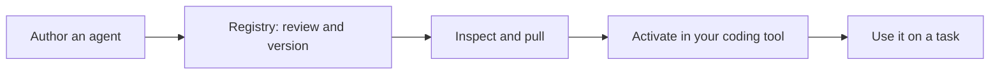

Agentic Resource Registry is a self-hosted registry for sharing coding agents and the resources they use. Publish an agent once, then pull its configuration into a supported coding tool instead of rebuilding that setup by hand.

An **agent** combines instructions with the MCP servers, skills, hooks, prompts, and sandboxes it needs. The registry keeps these resources versioned, controls who can access them, and generates configuration for the coding tool you choose.

<Note>
  These guides target stable v1.16.0. Pin that release rather than assuming a moving latest version matches; [match the documentation, CLI, and registry versions](/reference/documentation-version).
</Note>

## Start with an agent

<CardGroup cols={2}>
  <Card title="Join your team's registry" icon="users" href="/getting-started/onboarding">
    Install the CLI, sign in to an existing registry, and find an agent you can use.
  </Card>
  <Card title="Try a registry locally" icon="laptop" href="/getting-started/local-evaluation">
    Run an evaluation instance and try the same agent workflow before deploying for a team.
  </Card>
</CardGroup>

Already connected? [Pull your first agent](/getting-started/quickstart). Ready to publish your own? Follow the [agent authoring workflow](/guides/create-an-agent).

## How it fits together

The registry stores and distributes the setup. Your coding tool runs the agent. Pulling an agent does not give you a model-provider account or replace your coding tool's authentication.

An agent's declared harness support and the tool's capabilities determine what can be installed. See [supported coding tools](/integrations/index) before choosing a target.

## More than installing configuration

**Share and maintain resources.** Compose agents from reusable components, publish reviewed versions, fork an existing setup, and share it with a team. [Share agent configurations](/use-cases/share-agent-configs).

**Discover what already exists.** Search for resources that fit a task. Agentic Resource Discovery (ARD) supplies a structured discovery format; relevance, approval, compatibility, and availability are separate signals. [Discover resources with ARD](/guides/discover-resources).

**Delegate part of a task.** Agent-to-agent delegation uses A2A tasks for local registry agents and reviewed remote agent services. An installable agent and a remote service are different resources. [Delegate work with A2A](/guides/delegate-work).

**Learn from insights.** Agent reports help you examine how an agent is used and where it encounters friction. Component reports distinguish verified configuration from evidence of actual use; coverage varies by coding tool. [Interpret agent and component insights](/guides/interpret-insights).

Sessions and traces supply evidence for those reports and for debugging. They are useful after you start using an agent, not a prerequisite for finding and installing one. [Debug a failure using session evidence](/use-cases/debug-agent-failures).

## Choose the documentation you need

- **Use the registry:** start with [joining a registry](/getting-started/onboarding) and [pulling an agent](/getting-started/quickstart).
- **Connect a coding tool:** find its support and setup instructions under [Integrations](/integrations/index).
- **Operate a registry:** use the [self-hosting guides](/self-hosting/index) for deployment, authentication, backups, and upgrades.
- **Look up exact behavior:** use the [CLI reference](/cli/index), [API reference](/reference/api-endpoints), and [core concepts](/core-concepts/index).
