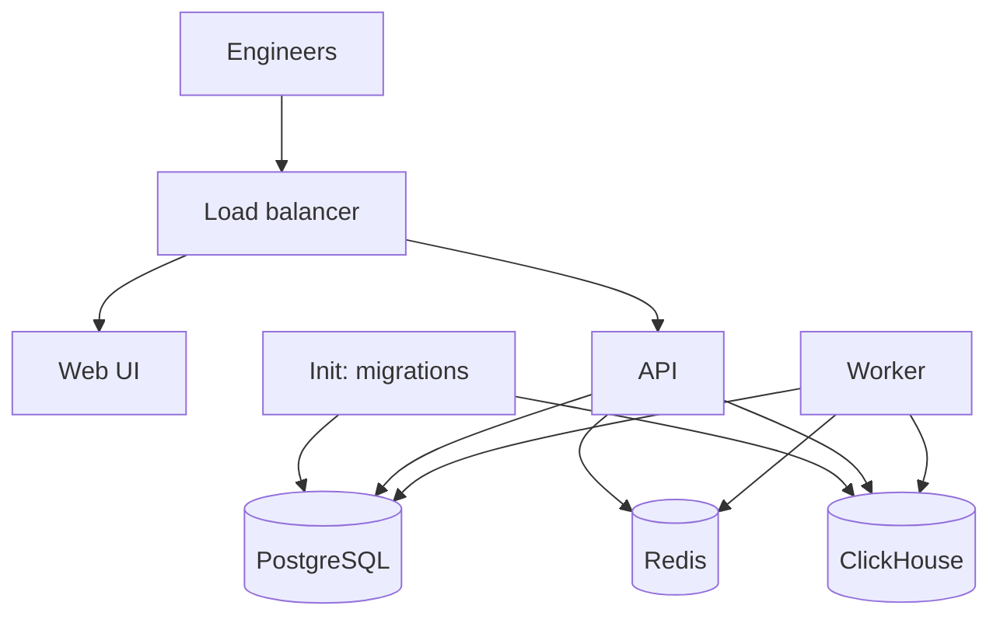

Run the registry on infrastructure you control. Self-hosting determines where the registry stores data; it does not guarantee zero network egress. Image downloads, identity providers, remote resources, and configured insights/model providers can make outbound requests. Review those integrations and your data-handling policy before deployment.

The packaged single-node installer is designed to generate restricted credential files under `secrets/`, record their `NAME_FILE` paths in `.env`, and bind new host ports to loopback. The source Compose path remains available for development and accepts direct `.env` values.

<Warning>
  Packaged setup currently fails on macOS's Bash 3.2 with an empty-array error. That limitation was reproduced independently of this docs PR. Use the [source evaluation path](/getting-started/local-evaluation), or validate the packaged setup with a compatible shell before relying on it. See [software requirements](/self-hosting/requirements#packaged-setup-on-macos).
</Warning>

## Architecture at a glance

The inventory below describes `docker/docker-compose.yml` in this documentation's source revision, not every deployment artifact. It has **eight core services**. The init service runs migrations and exits; it is not a continuously running application process.

| Core service | Source image or build | Purpose |
| --- | --- | --- |
| `observal-init` | `docker/Dockerfile.api` | Run database migrations, then exit |
| `observal-api` | `docker/Dockerfile.api` | Serve the registry API |
| `observal-web` | `docker/Dockerfile.web` | Serve the web UI |
| `observal-lb` | `nginx:1.31-alpine` | Route UI and API requests |
| `observal-db` | `postgres:18` | Store users, resources, reviews, and settings |
| `observal-clickhouse` | `clickhouse/clickhouse-server:26.6` | Store session and audit evidence |
| `observal-redis` | `redis:8-alpine` | Queue jobs, cache settings, and coordinate runtime services |
| `observal-worker` | `docker/Dockerfile.api` | Run background jobs |

Prometheus and Grafana are **optional overlay services**, not part of the eight-service core. `docker/docker-compose.observability.yml` adds Prometheus; its `grafana` profile enables Grafana:

| Optional service | Overlay image | Purpose |
| --- | --- | --- |
| `observal-prometheus` | `prom/prometheus:v3.12.0` | Collect operational metrics |
| `observal-grafana` | `grafana/grafana-oss:13.0.2` | View operational dashboards |

Core services share the `observal-net` network and persistent volumes `pgdata`, `chdata`, `redisdata`, and `apidata`. The Grafana overlay adds `grafanadata`. Network membership does not prevent exposure through published host ports; inspect [ports and volumes](/self-hosting/ports-and-volumes) before sharing the instance.

The downloadable server package has its own Compose files, image-version selection, and host bindings. Read the files shipped with your chosen release rather than applying source-stack defaults to it. See [documentation and software versions](/reference/documentation-version) and [requirements](/self-hosting/requirements).

## Choose the deployment artifact

Use the artifact you intend to operate, not a universal command copied from another deployment type:

| Path | When to use it | What to verify |
| --- | --- | --- |
| [Source Compose](/self-hosting/docker-compose) | Development evaluation or a deliberately maintained source deployment | Selected revision, effective environment, ports, migrations, and volume ownership. |
| Downloaded server package | A release-based single-node installation | Selected image tag, shipped files/secret mounts, staging versus cutover, and compatible shell. |
| [Kubernetes](/self-hosting/kubernetes-helm) | An existing Kubernetes operating environment | Chart/release compatibility, external storage, identity, migration ordering, and ingress. |
| [Cloud deployment](/self-hosting/production-deploy) | A reviewed AWS/GCP infrastructure deployment | Resource topology, IAM, backups, rollout, networking, and failure recovery. |

Templates do not guarantee availability, capacity, cost, or a fixed deployment time. Measure the intended workload and review the actual infrastructure plan. If your team already has a registry, use [existing-registry onboarding](/getting-started/onboarding) instead of deploying another server.

**Start here:**

| If you want to...                | Read                                                                                                                     |
| -------------------------------- | ------------------------------------------------------------------------------------------------------------------------ |
| Deploy on a single VM (simplest) | [Single-node deployment](/self-hosting/single-node-deploy)                                                                          |
| Deploy on Kubernetes with Helm   | [Kubernetes deployment with Helm](/self-hosting/kubernetes-helm) |
| Review a production cloud deployment     | [Production deployment](/self-hosting/production-deploy)                                                                            |
| Deploy on AWS specifically       | [AWS deployment with Terraform](/self-hosting/aws-terraform)                                                                        |
| Deploy on GCP specifically       | [GCP deployment with Terraform](/self-hosting/gcp-terraform)                                                                        |

**Then configure and operate:**

| If you want to...                     | Read                                        |
| ------------------------------------- | ------------------------------------------- |
| Confirm your machine can run Agentic Resource Registry | [Requirements](/self-hosting/requirements)             |
| Get the stack running locally for dev | [Docker Compose setup](/self-hosting/docker-compose)   |
| Know every env var that matters       | [Configuration](/self-hosting/configuration)           |
| See every port and volume at a glance | [Ports and volumes](/self-hosting/ports-and-volumes)   |
| Understand the DBs and retention      | [Databases](/self-hosting/databases)                   |
| Set up SSO, JWT keys, demo accounts   | [Authentication and SSO](/self-hosting/authentication) |
| Understand session delivery           | [Session tracking and reconciliation](/core-concepts/session-tracking) |
| Upgrade safely                        | [Upgrades](/self-hosting/upgrades)                     |
| Back up and restore                   | [Backup and restore](/self-hosting/backup-and-restore) |
| Fix something that's broken           | [Troubleshooting](/self-hosting/troubleshooting)       |

## Production checklist

Before putting Agentic Resource Registry in front of real users:

1. **Protect `SECRET_KEY`**: server-package setup generates it in `secrets/`; source deployments must set a strong direct value or `SECRET_KEY_FILE`.
2. **Protect database passwords**: server-package setup generates restricted PostgreSQL and ClickHouse credential files; source deployments must replace the `.env.example` defaults.
3. **Scope `CORS_ALLOWED_ORIGINS`** to your real frontend host.
4. **Configure SSO** in **Admin → SSO**, including `deployment.sso_only` if you want SSO-only login.
5. **Configure auth rate limits** through `security.rate_limit_auth` and `security.rate_limit_auth_strict`, then verify startup-bound behavior.
6. **Set `data.retention_days` and the separate application retention policy** to match privacy/storage requirements; verify the actual TTL.
7. **Back up the JWT key volume** (`apidata`): losing it invalidates every session.
8. **Remove demo access**: explicitly clear source service defaults or review packaged credential files, then remove existing demo users through an authorized account. See [demo configuration](/self-hosting/configuration#demo-accounts).
9. **Review outbound reporting and providers**: [usage reporting](/self-hosting/usage-reporting) is enabled by default; self-hosting is not a zero-egress guarantee.

Each of these is covered in the linked deep-dive below. Start with [Requirements](/self-hosting/requirements).
