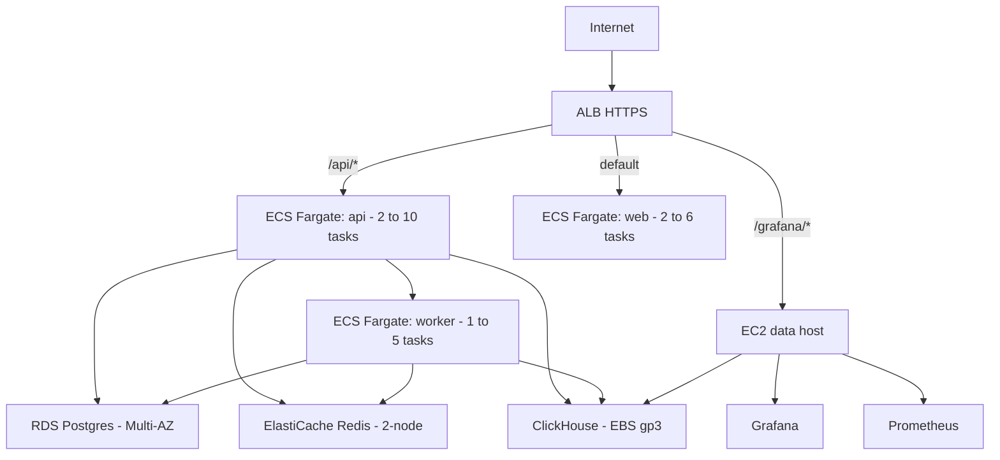
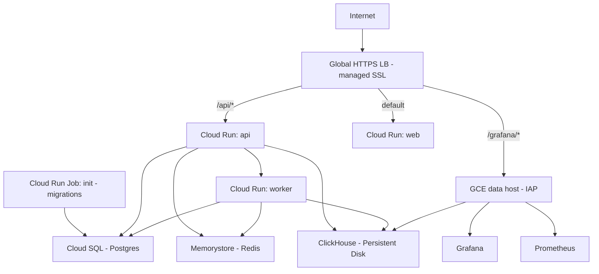

Review the AWS or GCP Terraform topology when a single-host source deployment is not the intended operating model. Managed services and autoscaling options do not by themselves certify availability, capacity, or a safe rollout.

**Goal:** an explicitly configured cloud deployment with verified identity, networking, migration ordering, and full recovery. A successful `terraform apply` or managed database snapshot is not proof that every application artifact is backed up or that the complete registry works.

## When to use this vs. single-node

| | [Single-node](/self-hosting/single-node-deploy) | Production (this guide) |
|---|---|---|
| **Best for** | Small/mid teams, internal use, POCs | Enterprise, SLA-bound, high-traffic |
| **Infra** | 1 VM, any cloud or on-prem | ~100 managed cloud resources |
| **HA** | Single-host failure boundary | Configured replication/topology; verify failover and application recovery |
| **Failover** | Rehearsed host/data recovery | Provider behavior and application recovery require testing |
| **Scaling** | Vertical (bigger VM) | Horizontal (add more containers) |
| **Backups** | Verified scheduled procedure required | Inspect snapshots/jobs and rehearse complete multi-store recovery |
| **Secrets** | Server-package files, or direct `.env` values for source Compose | SSM Parameter Store / Secret Manager (encrypted, auditable) |
| **Logging** | `docker compose logs` | CloudWatch / Cloud Logging (centralized, retained, searchable) |

## Choose your cloud

Agentic Resource Registry ships Terraform modules for both AWS and GCP. They use different provider services and lifecycle mechanisms. Review the actual plan and selected configuration rather than assuming equivalent behavior.

### AWS



| Component | AWS Service | Notes |
|---|---|---|
| Compute (stateless) | ECS Fargate | api, web, worker as separate services |
| Postgres | RDS Postgres 16 | Multi-AZ on prod, encrypted, automated backups |
| Redis | ElastiCache Redis 7 | 2-node replication, automatic failover on prod |
| ClickHouse | EC2 + EBS gp3 | Self-hosted |
| Load balancer | ALB | HTTPS via ACM, path-based routing |
| Secrets | SSM Parameter Store | Encrypted with KMS, injected into ECS tasks |
| Logging | CloudWatch | Per-service log groups |
| Backups | S3 + RDS snapshots | Lifecycle: Standard → IA → Glacier → expire |
| DNS | Route 53 | Optional; works without a custom domain |

**Full walkthrough:** [AWS deployment with Terraform](/self-hosting/aws-terraform)

**Quick start:**

Do not apply the stock AWS template until the [v1.16.0 shared/durable signing-key prerequisite](/self-hosting/aws-terraform#quickstart) is satisfied. The default per-task temporary keys are not a safe authenticated multi-task deployment.

```bash
git clone --branch v1.16.0 --depth 1 https://github.com/AgenticResourceRegistry/AgenticResourceRegistry.git
cd AgenticResourceRegistry/infra/terraform/aws

# Configure
cp terraform.tfvars.example terraform.tfvars
# Edit: region, environment, domain_name (optional), alb_ingress_cidrs.
# REQUIRED: image_tag = "1.16.0", not the copied latest default.

# Deploy
terraform init
terraform plan -out tf.plan
# Review effective application image references for :1.16.0 before applying.
terraform apply tf.plan

# Verify
terraform output app_url
curl -fsS "$(terraform output -raw app_url)/readyz"
```

Apply takes ~20–30 minutes (RDS Multi-AZ provisioning dominates). Baseline cost: **~$255/mo** in us-east-1.

### GCP



| Component | GCP Service | Notes |
|---|---|---|
| Compute (stateless) | Cloud Run v2 | api, web, worker as separate services |
| Migrations | Cloud Run Jobs | One-shot init task |
| Postgres | Cloud SQL | HA configuration available |
| Redis | Memorystore | Managed Redis |
| ClickHouse | GCE instance | Docker Compose on a single VM |
| Load balancer | Global HTTPS LB | Managed SSL certificate |
| Secrets | Secret Manager | Injected into Cloud Run at start |
| Logging | Cloud Logging | Built-in, no config needed |
| Backups | GCS | Versioned bucket with lifecycle |
| DNS | Cloud DNS | Optional |
| Shell access | IAP SSH tunnel | No public SSH, no SSH keys |

**Full walkthrough:** [GCP deployment with Terraform](/self-hosting/gcp-terraform)

**Quick start:**

Resolve the [v1.16.0 GCP shared/durable signing-key prerequisite](/self-hosting/gcp-terraform#quickstart) before applying the stock Cloud Run template for authenticated team use.

```bash
cd AgenticResourceRegistry/infra/terraform/gcp

# Enable required APIs
gcloud services enable \
  run.googleapis.com sqladmin.googleapis.com redis.googleapis.com \
  compute.googleapis.com secretmanager.googleapis.com \
  dns.googleapis.com vpcaccess.googleapis.com \
  servicenetworking.googleapis.com

# Configure
cp terraform.tfvars.example terraform.tfvars
# Edit: project_id, region, domain_name (optional).
# REQUIRED: image_tag = "1.16.0", with those exact images in the configured mirror.

# Deploy
terraform init
terraform plan -out tf.plan
# Review effective application image references for :1.16.0 before applying.
terraform apply tf.plan

# Run migrations
gcloud run jobs execute observal-prod-init --region=us-central1

# Verify
terraform output app_url
```


## Day-2 operations

These apply to both AWS and GCP. Cloud-specific commands are in the respective guides.

### Upgrade to a new release

Use the [canonical upgrade gates](/self-hosting/upgrades) and the selected cloud's migration lifecycle. Choose an actual released image tag and review its schema compatibility before changing infrastructure. Drain incompatible old API/worker writers before migration; no template dependency proves they have stopped.

- **AWS:** the module's optional `run_init_on_apply` task trigger runs and waits for the initializer, checking its exit code. New service dependencies do not automatically stop existing running tasks before that migration.
- **GCP:** creating/updating the init-job resource is not execution. The operator must run the intended job, wait for completion, inspect its result, and control traffic/writers during an incompatible migration.

Verify initialization, selected versions, policy, and the user-facing route before restoring traffic. Rolling compute behavior does not guarantee zero downtime or migration safety. The cloud guides provide source-specific details; they are not a production rollout rehearsal.

### Roll back

Changing an image tag and applying prior infrastructure does not undo schema or data mutations. Determine what migrations completed and whether prior application versions can read/write the resulting state. Use verified snapshots plus matching encryption/signing/application artifacts if data recovery is required. Follow [rollback and recovery](/self-hosting/upgrades#rolling-back); do not assume database data is unaffected by the failed upgrade.

### Scale up

Adjust variables in `terraform.tfvars`:

```hcl
# More API containers
api_desired_count  = 4
api_autoscale_max  = 20

# Bigger database
db_instance_class  = "db.m6g.large"      # AWS
# postgres_tier    = "db-custom-4-16384"  # GCP

# Bigger ClickHouse host
data_instance_type = "m6i.xlarge"        # AWS
# data_machine_type = "e2-standard-4"    # GCP
```

```bash
terraform apply
```

### Tear down

```bash
terraform destroy
```

On prod, databases have deletion protection enabled. Disable manually before destroy if you really mean it.

## Cost comparison

### AWS (us-east-1, on-demand)

| Component | Spec | ~$/month |
|---|---|---|
| Fargate api 2× | 0.5 vCPU / 1 GB | $30 |
| Fargate web 2× | 0.25 vCPU / 0.5 GB | $15 |
| Fargate worker 1× | 0.5 vCPU / 1 GB | $15 |
| EC2 data host | t3.large | $60 |
| RDS Postgres Multi-AZ | db.t4g.small | $50 |
| ElastiCache Redis 2× | cache.t4g.micro | $25 |
| ALB | — | $20 |
| NAT Gateway | — | $33 + egress |
| EBS gp3 100 GB | — | $8 |
| S3 backups | ~1 GB cold | $0.10 |
| **Total** | | **~$255** |

Set `environment = "staging"` to halve the bill (single-AZ RDS, one Redis node, no deletion protection).

### GCP (us-central1, on-demand)

| Component | Spec | ~$/month |
|---|---|---|
| Cloud Run api | 1 vCPU / 512 MB, min 1 instance | $25 |
| Cloud Run web | 1 vCPU / 256 MB, min 1 instance | $15 |
| Cloud Run worker | 1 vCPU / 512 MB, min 1 instance | $25 |
| Cloud SQL Postgres | db-f1-micro (shared) | $10 |
| Memorystore Redis | 1 GB basic | $35 |
| GCE data host | e2-standard-2 | $50 |
| Global HTTPS LB | — | $18 |
| Persistent Disk 100 GB | — | $4 |
| GCS backups | ~1 GB cold | $0.02 |
| **Total** | | **~$180** |

GCP is typically cheaper due to Cloud Run's per-request billing and no NAT Gateway equivalent charge.

## Production hardening checklist

Applies to both clouds. See the cloud-specific guides for implementation details.

- Enable remote Terraform state (S3 + DynamoDB on AWS, GCS on GCP)
- Restrict load balancer ingress to known CIDRs
- Enable cloud security services (GuardDuty + Config on AWS, Security Command Center on GCP)
- Set up alerting on database CPU, memory, and 5xx error rates
- Attach a WAF to the load balancer
- Enable Redis transit encryption
- Configure [SSO](/self-hosting/authentication) (SAML or OIDC)
- Test the [backup and restore](/self-hosting/backup-and-restore) procedure end-to-end
- Replace the GitHub tarball pull in the data host bootstrap with an artifact you control

## Next

- [AWS deployment with Terraform](/self-hosting/aws-terraform) — full AWS walkthrough
- [GCP deployment with Terraform](/self-hosting/gcp-terraform) — full GCP walkthrough
- [Configuration](/self-hosting/configuration) — environment variables reference
- [Upgrades](/self-hosting/upgrades) — upgrade and rollback procedures
- [Backup and restore](/self-hosting/backup-and-restore) — detailed restore procedures
