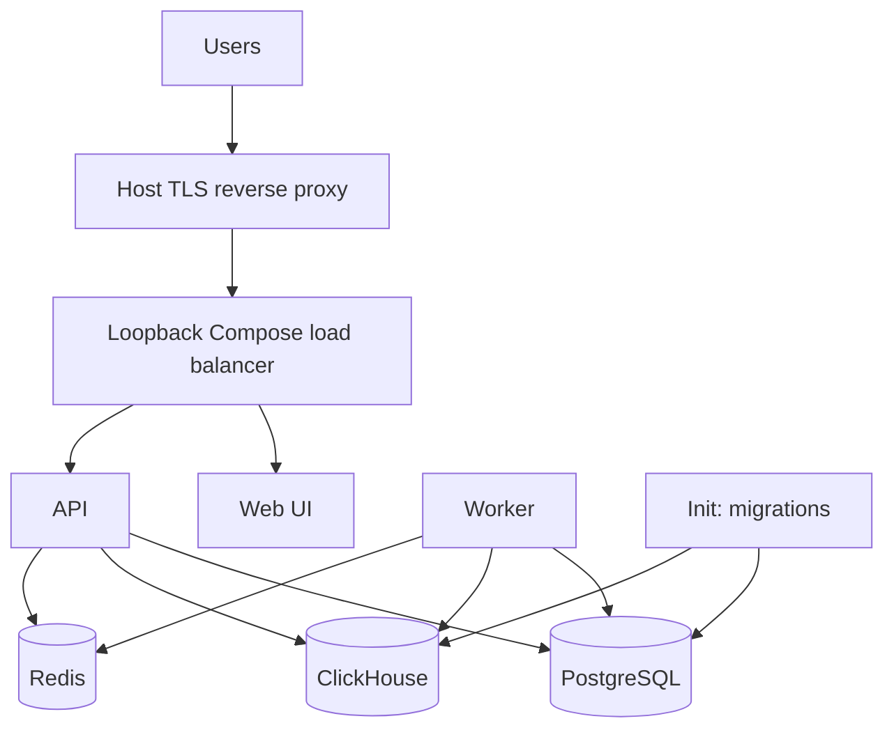

Use this path when you intend to maintain the source Compose stack on one Linux VM. The goal is a healthy registry behind a restricted TLS entry point, with real operator access and a tested recovery procedure. Compose does not automatically provide complete off-host backups, a fixed deployment time, or zero-downtime upgrades.

This development-checked guide is not a stable production certification. Select and verify the intended software release before team access. If you only want to try pulling an agent, use [local evaluation](/getting-started/local-evaluation).

## When to use this vs. the Terraform module

A single VM is simpler to operate but has a single-host failure boundary. [Cloud templates](/self-hosting/production-deploy) offer different managed-service topologies; their presence does not guarantee availability or migration compatibility. Choose based on measured workload, recovery objectives, networking, and operational ownership—not a promised number of users or monthly cost.

## Architecture



The source load balancer routes HTTP; it does not terminate TLS by default. The host proxy example below is separate from the Compose containers. Init runs and exits; optional monitoring is not part of the eight-service core.

## Prerequisites

Choose a current Linux VM/image compatible with the container architectures and [resource requirements](/self-hosting/requirements). You need restricted administrative access, a domain and approved TLS procedure, storage/backup headroom, Docker, and a Compose version supporting the shown override semantics.

Host commands below run on the VM, from its source checkout unless stated otherwise. A `127.0.0.1` URL refers to that host; a CLI on your own machine needs an authorized tunnel or the verified public endpoint.

Use a supported, patched Docker Engine **28 or newer** for this loopback/TLS layout. [Docker documents that older Engines can expose localhost-published ports to hosts on the same L2 network](https://docs.docker.com/engine/network/port-publishing/#publishing-ports), bypassing the host TLS proxy. Verify ordinary NAT/default routing and host firewall assumptions; do not enable direct/routed or unprotected networking as a workaround.

The example uses `!override`, which requires Compose **2.24.4 or newer**. [Docker's merge documentation](https://docs.docker.com/reference/compose-file/merge/) explains why ordinary port-list merging would otherwise retain the old public bindings. Do not simply remove the tag on an older client.

## Step 1: Provision the VM

Use your provider's reviewed image, disk, identity, and firewall setup. Restrict administrative access. Record the VM, storage, domain, recovery owner, and planned application exposure. A stale hardcoded AMI or estimated team-size table is not a valid provisioning plan.

## Step 2: Install Docker

Install a supported Docker Engine and Compose using [the maintained Docker installation instructions](https://docs.docker.com/engine/install/) for your operating system/provider, then verify:

```bash
docker version
docker compose version
```

Docker administrative access is privileged. Do not add accounts to its administrative group without reviewing that trust boundary.

## Step 3: Clone and configure

Select the reviewed source revision:

```bash
git clone --branch v1.16.0 --depth 1 https://github.com/AgenticResourceRegistry/AgenticResourceRegistry.git
cd AgenticResourceRegistry
cp .env.example .env
```

Do **not** rotate only `POSTGRES_PASSWORD` and `CLICKHOUSE_PASSWORD`. Prepare the [coordinated configuration](/self-hosting/configuration#database-connections): database credentials, correctly encoded application connection URLs or files, API/worker/init consumers, and health-check credentials must agree. Changing an environment password is not a universal credential-rotation procedure for an existing database volume.

Preserve a strong application encryption secret with the recovery configuration. Configure actual process CORS and the runtime frontend URL through their distinct mechanisms. See [configuration](/self-hosting/configuration), [authentication](/self-hosting/authentication), and [secret files](/self-hosting/configuration#secret-files).

Source Compose supplies demo fallbacks even when `.env` lines are removed. Create a reviewed `compose.single-node.override.yml` at the checkout root to clear those API inputs and keep app listeners off public interfaces:

```yaml
services:
  observal-api:
    environment:
      DEMO_SUPER_ADMIN_EMAIL: ""
      DEMO_SUPER_ADMIN_PASSWORD: ""
      DEMO_ADMIN_EMAIL: ""
      DEMO_ADMIN_PASSWORD: ""
      DEMO_REVIEWER_EMAIL: ""
      DEMO_REVIEWER_PASSWORD: ""
      DEMO_USER_EMAIL: ""
      DEMO_USER_PASSWORD: ""
  observal-lb:
    ports: !override
      - "127.0.0.1:8080:80"
  observal-web:
    ports: !override
      - "127.0.0.1:3000:3000"
```

Verify the merged model's bindings and demo suppression without printing credentials into shared logs. Keep the same project, files, environment file, and optional profiles on every later operation. This override does not supply coordinated database secrets or complete production hardening by itself.

## Step 4: Set up TLS

Prepare an approved host proxy/ingress with access to the restricted upstream. If using Caddy, follow its [installation instructions](https://caddyserver.com/docs/install) before configuring the service. This example uses a host Caddy configuration after the loopback port-8080 override above:

```caddyfile
registry.example.com {
    reverse_proxy 127.0.0.1:8080
}
```

Replace the domain and configure its DNS, certificates, proxy policy, and renewal monitoring. Using port 8080 avoids competing with the proxy's public HTTP listener on port 80. Keep the public application route closed until first-admin and configuration checks complete.

If using a cloud load balancer or a reviewed TLS Compose overlay instead, verify that artifact's certificate mounts, bindings, allowed origins, health route, and trust settings. Do not combine two listeners on the same host port or assume a firewall alone blocks Docker-published ports.

## Step 5: Start the stack

For a **fresh deployment only**, from the configured checkout:

```bash
docker compose --env-file .env -f docker/docker-compose.yml -f compose.single-node.override.yml up --build -d
docker compose --env-file .env -f docker/docker-compose.yml -f compose.single-node.override.yml ps -a
docker compose --env-file .env -f docker/docker-compose.yml -f compose.single-node.override.yml logs --tail 50 observal-init
curl http://127.0.0.1:8080/health
```

Include your actual project/overlay/profile flags. Check successful init and the health response body; HTTP 200 alone does not establish readiness. On a fresh non-demo server, `initialized: false` is expected until the first administrator is created. Existing-data changes are upgrades, not this fresh-start recipe.

## Step 6: Survive reboots

Review Docker service startup and the containers' declared restart policies. Those policies help recovery but do not prove healthy ordering or a successful reboot. Rehearse a reboot and inspect successful init state, dependency/API health, worker status, and the public route after reconnecting. Init is not expected to remain running.

## Step 7: Set up verified backups

Follow [backup and restore](/self-hosting/backup-and-restore) using the actual mounts and credentials. Preserve PostgreSQL, complete application artifacts/signing material, matching encryption configuration and mounted secrets, and the ClickHouse evidence your recovery objectives require. Plan Redis and custom monitoring state separately.

Only automate a procedure after a separate restore rehearsal passes. Its non-interactive environment must have the intended project/files, restricted credentials, storage destination, failure reporting, and a tested retention/pruning policy. Off-host delivery is complete only after upload, integrity/access checks, and restoration are verified—not because an S3 command appears in a comment.

A ClickHouse `Disk('backups', ...)` destination must be configured and tested before a native backup schedule is used. Do not add a cron entry that assumes that disk or a shell password environment exists. No complete backup automation is provisioned by this page.

## Step 8: First login and opening access

While the public route remains closed, [install a matching CLI](/getting-started/installation) using the [version guidance](/reference/documentation-version), then initialize on the VM or through an authorized tunnel to its restricted listener:

```bash
observal auth login --server http://127.0.0.1:8080 --no-setup
observal auth whoami
```

Follow [first-admin guidance](/self-hosting/authentication#the-first-administrator). Do not leave demo credentials as production access. Establish required operator authority, the runtime `deployment.frontend_url`, actual CORS, proxy trust, registration/public-registry policy, and usage-reporting decisions before opening the public route.

Then enable the reviewed TLS proxy, verify through the real HTTPS origin, and test an ordinary-user [inspect/pull/activate workflow](/getting-started/quickstart). Signing in to the registry does not authenticate a coding tool's model account.

## Upgrades

Use the [canonical upgrade procedure](/self-hosting/upgrades) for your deployment artifact. Select the intended revision, preserve verified backups, and drain incompatible old API/workers **before** a new initializer migrates the database. A generic checkout plus `up --build` is not a safe universal upgrade.

Do not copy a historical target or treat CLI-managed Docker upgrade commands as the workflow for every source deployment. Image rollback and data recovery are different operations.

## Monitoring

Review the optional [source monitoring overlay](/self-hosting/docker-compose#start-the-stack). Keep its files/profiles consistent across operations. Access private dashboards through an authorized tunnel or protected route; do not expose a plaintext direct web/Grafana listener merely to inspect it.

Monitor the health body/dependencies, failed jobs, applied retention, backup completion, and restore results—not only a successful `curl` exit status. A configured 90-day retention value is not proof of effective TTL; use the [read-only retention checks](/self-hosting/data-retention#verify-storage-and-scheduled-retention).

## Security hardening

Before team access, verify coordinated credentials, cleared demo fallbacks and existing demo-account removal, restricted host bindings, TLS/proxy policy, authorized account/recovery access, applied retention, reporting consent, and restorable backups. The [assurance case](/security/assurance-case) describes limitations; a checklist or template alone is not security certification.

## Scaling up

Measure latency, database growth, queues, and recovery time before changing capacity. More workers/tasks do not automatically fix database bottlenecks or make migrations compatible. For a different topology, review the [cloud deployment guide](/self-hosting/production-deploy) and its actual storage, identity, migration, and recovery requirements.

## Next

[Configuration](/self-hosting/configuration) → [authentication](/self-hosting/authentication) → [backup/recovery](/self-hosting/backup-and-restore) → [upgrades](/self-hosting/upgrades).
