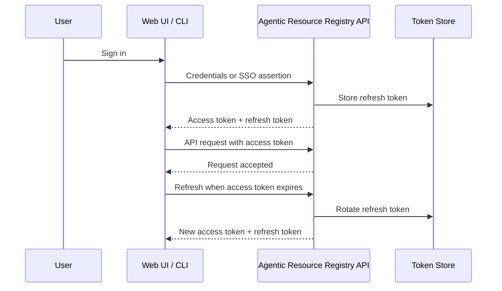

Most deployments don't need to change these. The defaults (60-minute access tokens, 30-day refresh tokens) work well for typical teams. Read on if you have compliance requirements, high-security needs, or users complaining about session behavior.

## Token Lifecycle



> **Tip:** Access JWTs are signature/expiry checked and also subject to Redis revocation checks and relevant account state. They are not irrevocable or signature-only. Refresh credentials have their own stored validation/revocation lifecycle; do not assume changing their expiry alone invalidates every already-issued access token.

## Recommended Configurations

Pick the row that matches your environment:

| Scenario | Access Token | Refresh Token | Refresh Mode | Hooks Token | Notes |
|----------|-------------|---------------|--------------|-------------|-------|
| **Development / local** | 60 min | 30 days | Sliding | 43200 min (30 days) | Defaults. Minimal re-auth friction. |
| **Production (standard)** | 30 min | 14 days | Absolute | 43200 min (30 days) | Good balance of security and UX. |
| **High-security / SOC 2** | 15 min | 24 hours | Absolute | 1440 min (1 day) | Short sessions, frequent re-auth. Set NTP sync. |
| **Shared workstations** | 15 min | 8 hours | Absolute | 480 min (8 hours) | Sessions don't survive shift changes. |
| **CI/CD service accounts** | 60 min | 90 days | Absolute | 43200 min (30 days) | Use an approved JWT access-token file for CI and replace its 60-minute JWT through an authorized issuance/renewal process before expiry and later scheduled runs. A clean runner has no stored refresh credential: the 90-day setting does not renew this file. There is no registry API-key authentication path. |

## How to Change

1. Go to **Settings > Security > Token Expiry** in the admin panel.
2. Adjust the values per the table above.
3. Save.

> **Warning:** Changing expiry does NOT retroactively affect existing tokens. Already-issued tokens keep their original TTL. To force all users to re-authenticate, use the "Revoke all sessions" action.

## Verify it works

This example requires a fresh interactive `observal auth login` with a persisted `access_token` in the selected registry configuration. It does not inspect `OBSERVAL_ACCESS_TOKEN_FILE` or work as a clean-runner CI verification step. If using a CI access-token file, verify that actual newly issued JWT through the approved issuance/expiry-checking process; do not inspect an unrelated saved login token.

Decode the persisted interactive token locally to confirm the new expiry:

```bash
# Read only expiry metadata locally; do not print the token or full payload.
python3 - "$(observal config path)" <<'PY'
import base64
import json
import sys
from pathlib import Path
encoded = json.loads(Path(sys.argv[1]).read_text())["access_token"].split(".")[1]
payload = json.loads(base64.urlsafe_b64decode(encoded + "=" * (-len(encoded) % 4)))
print({"iat": payload.get("iat"), "exp": payload.get("exp"),
       "ttl_seconds": payload["exp"] - payload["iat"]})
PY
```

Check the `exp` claim — it should be `iat` + your configured access token TTL (in seconds).


## General Guidance

- **Never set access tokens longer than refresh tokens.** The system enforces this, but attempting it produces a validation error.
- **Clock synchronization matters.** JWTs use `exp` / `iat` claims. If your server clock drifts >30 seconds from client clocks, tokens will be rejected prematurely or accepted past expiry. Use NTP.
