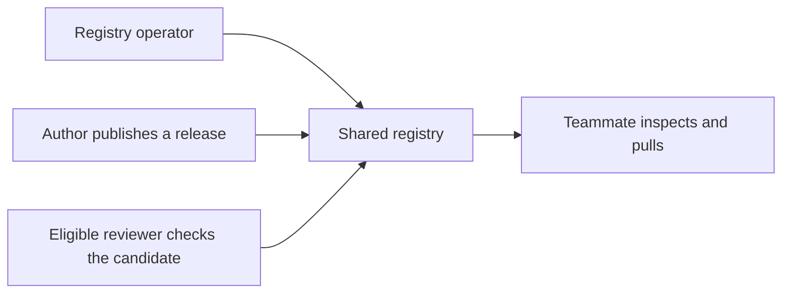

A shared registry gives a team one place to maintain approved agents and reusable components. The operational goal is a repeatable release and access workflow—not collecting every developer session by default.

## What changes at team scale

Decide four things explicitly:

- **Connection:** registry URL, authentication, and account provisioning.
- **Namespace/access:** personal versus team resources, membership, and visibility.
- **Publication:** eligible reviewers, counted approvals, checks, and final release state.
- **Evidence:** what sessions may be collected, who may view them, and effective retention.

None of these substitutes for another. SSO authentication alone is not proof of team membership; a team role is not a server role; approval does not always publish; a valid agent share link does not grant access.

## Setup shape

Deploy one supported registry and direct teammates to it:



Use the [operator setup](/self-hosting/index), [authentication](/self-hosting/authentication), and [configuration](/self-hosting/configuration) guides. Do not copy a generic OIDC setting table or restart recipe from this use case: supported identity flows, boot-time/dynamic boundaries, and rollout validation belong in those canonical guides.

## Users and roles

Provision accounts through the supported operator flow. Server roles (`user`, `reviewer`, `admin`, `super_admin`) govern deployment-level authority. Team roles (`member`, `reviewer`, `owner`) govern a namespace. Global reviewer authority alone does not make another team's private resources visible; deployment administrators have broader privileges.

Use [teamspaces](/use-cases/teamspaces) for member/owner responsibilities and [review policy](/guides/review-and-publish) for publication. Team owners can record self-approval, but the effective gate decides whether it counts. Do not promise separation of duties based solely on a role label.

## Onboarding a new engineer

Send the approved registry URL and account/SSO instructions, then link [existing-registry onboarding](/getting-started/onboarding). If they need a private teamspace, complete its invitation/request/owner-approval path before sending team-private resources.

The engineer checks visible teams and agents:

```bash
observal team list --output json
observal agent list --output json
observal scan --inventory --output json
```

Plain `scan` is not the read-only inventory contract. No hardcoded corporate URL, installation shell pipe, default shared password, or automatic instrumentation is required here. Follow [first-agent installation](/getting-started/quickstart) with the actual qualified name and exact release.

## Review workflow

Choose a team-private candidate, assign eligible reviewers, inspect its instructions/components/source and exact version, then verify the gate and final publication state. Use [Review and publish](/guides/review-and-publish) rather than a competing abbreviated approval recipe.

Reviewers should check required secrets/binaries, tool permissions, native compatibility, source/ref immutability, hooks/scripts, resource isolation limits, and collection behavior—not just the description. A source tag can be retargeted; publication and file generation do not prove native execution.

## Telemetry across the whole team

Session capture is optional and permission-sensitive. A shared server does not mean every teammate's sessions are captured, readable by everyone, or retained for a promised duration. Review the [capture contract](/core-concepts/session-tracking), the applicable access/collection policy, and [effective retention checks](/self-hosting/data-retention) before enabling it.

Use [insights](/guides/interpret-insights) when coverage and authorized evidence answer a specific question. Unsupported or missing evidence is not zero use. Rankings are not a mandatory collaboration checkpoint.

## SSO and audit considerations

Verify the real login/provisioning and permission outcomes on your deployment. SSO, audit records, team membership, resource visibility, and session privacy are distinct controls. Follow [authentication and SSO](/self-hosting/authentication) for supported flows and [security assurance guidance](/security/assurance-case) for operator boundaries.

## Next

[Create/join a teamspace](/use-cases/teamspaces) → [publish a reviewed release](/guides/review-and-publish) → [share its exact version](/use-cases/share-agent-configs) → [follow decisions in Inbox](/guides/manage-inbox).
