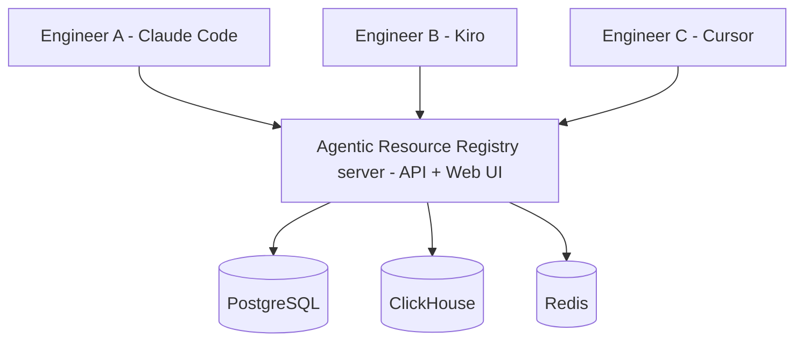

Once two or more people are authoring agents, you need a single source of truth. Agentic Resource Registry becomes your team's internal Docker Hub for AI agents, with review, RBAC, and telemetry baked in.

## What changes at team scale

* **Discovery**: teammates search one registry, with results scoped to their account and teamspace access.
* **Review**: eligible reviewers approve submitted revisions, and the publication gate controls which releases become available. Installing an author's own pending agent depends on `security.allow_draft_install`; it is not always allowed.
* **Governance**: RBAC roles (`super_admin`, `admin`, `reviewer`, `user`) control who can publish and approve.
* **Visibility**: centralized dashboards instead of "ask Sarah which version she's running."

## Setup shape

Deploy once, everyone points at it.



Install the server once ([Self-Hosting](/self-hosting)). Then every engineer installs the CLI and runs `observal auth login` pointed at your shared server URL.

## Users and roles

Server roles and teamspace permissions determine what an account can do. The roles below are a summary, not a promise of access to every private resource.

| Role | Can | Cannot |
| --- | --- | --- |
| `user` | Submit resources, install accessible releases, view authorized session evidence | Global review and server-administration operations |
| `reviewer` | Review submissions within their authorized scope | Server settings and user management reserved for administrators |
| `admin` | Manage permitted users, settings, and review operations | Operations reserved for super admins or restricted by policy |
| `super_admin` | Manage server-wide administrative policy and permitted operations | Role elevation does not remove privacy, review, or security boundaries |

Manage users:

```bash
observal admin users --output json
observal admin reset-password <email> --generate --output json
observal admin delete-user <email> --force --output json
```

Change a role via the web UI (`/settings/users`) or the API (`PUT /api/v1/admin/users/{id}/role`).

## Onboarding a new engineer

Give them the registry URL, an account or invitation, and the [existing-registry onboarding guide](/getting-started/onboarding). For example:

```bash
# The new engineer runs:
curl -fsSL https://raw.githubusercontent.com/AgenticResourceRegistry/AgenticResourceRegistry/main/install.sh | bash
observal auth login --server https://observal.your-company.internal --no-setup
```

For managed deployments, users authenticate through SSO or are provisioned by an admin. See [Authentication and SSO](/self-hosting/authentication).

After logging in, they can:

```bash
observal agent list                                  # approved agents visible to this account
observal agent show platform/team-reviewer --output json
observal scan --inventory                             # read-only local inventory
```

`platform/team-reviewer` is illustrative. Follow [Pull your first agent](/getting-started/quickstart) to inspect the exact release, preview, install, and activate it. Configure session capture separately when you have a reason and permission to collect that data.

## Review workflow

Authors submit revisions. Eligible reviewers inspect and approve them. Approval may not publish automatically; check the publication gate and final state. [Review and publish](/guides/review-and-publish) includes the web UI path.

```bash
observal review list --output json
observal review show <number> --output json
observal review approve <number> --output json
observal review request-changes <number> --body "missing env var docs" --output json
observal review publish <number> --output json
```

What reviewers look for:

* Does the README/description make it clear what the component does?
* Does the MCP analysis (from `submit`) look correct: tools, env vars, transport?
* Are required env vars documented?
* Is the repo URL trustworthy (pinned commit or tag)?

Everything published is visible to the author immediately. Review controls what appears in the public listing.

## Telemetry across the whole team

Because every engineer's session telemetry flows into the same server, `observal ops` becomes a team dashboard:

```bash
observal ops top --type agent           # most-used agents across the team
observal ops top --type mcp             # hottest MCP servers
```

Filters in the web UI let you slice by user, agent, harness, and time range.

## SSO and audit considerations

For orgs that need SSO and audit logging, configure OIDC in **Admin → SSO**:

| Setting | Value |
| --- | --- |
| `oauth.client_id` | Your IdP client ID |
| `oauth.client_secret` | Your IdP client secret |
| `oauth.server_metadata_url` | Your IdP discovery URL |

Restart the API after OIDC changes. See [Authentication and SSO](/self-hosting/authentication).

## Next

→ [Self-Hosting](/self-hosting): the operator's playbook for actually running the server this use case depends on.
